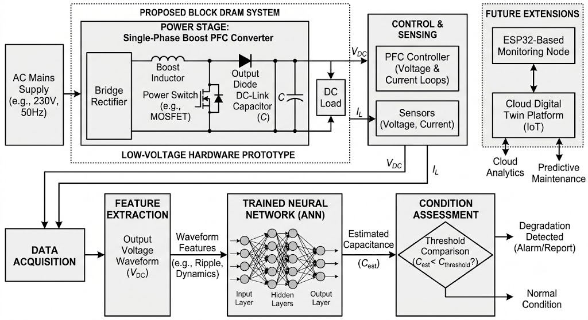
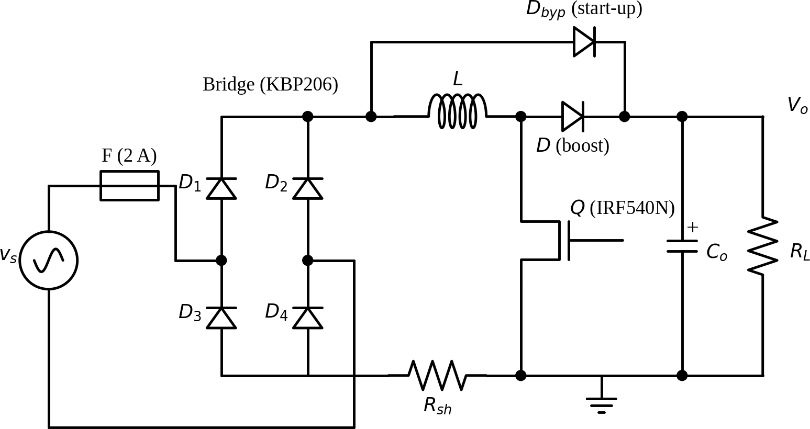
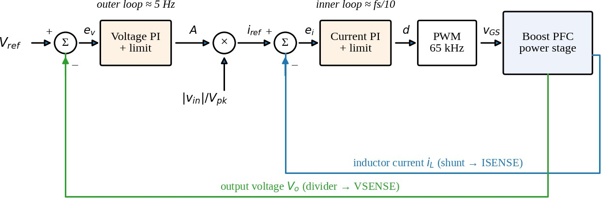
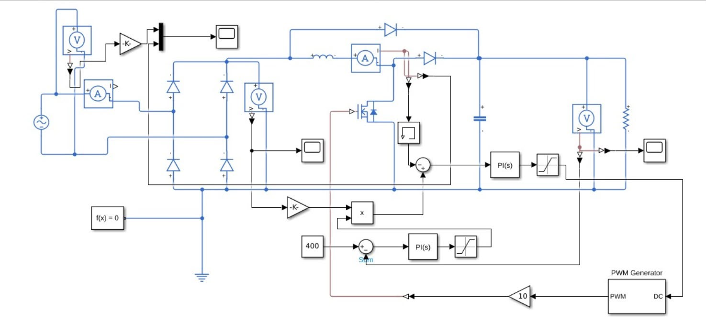
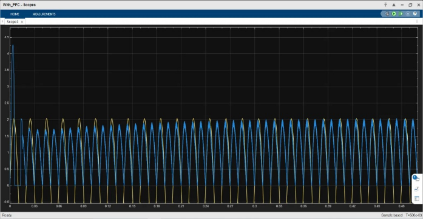
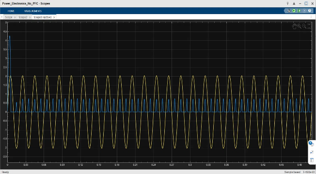
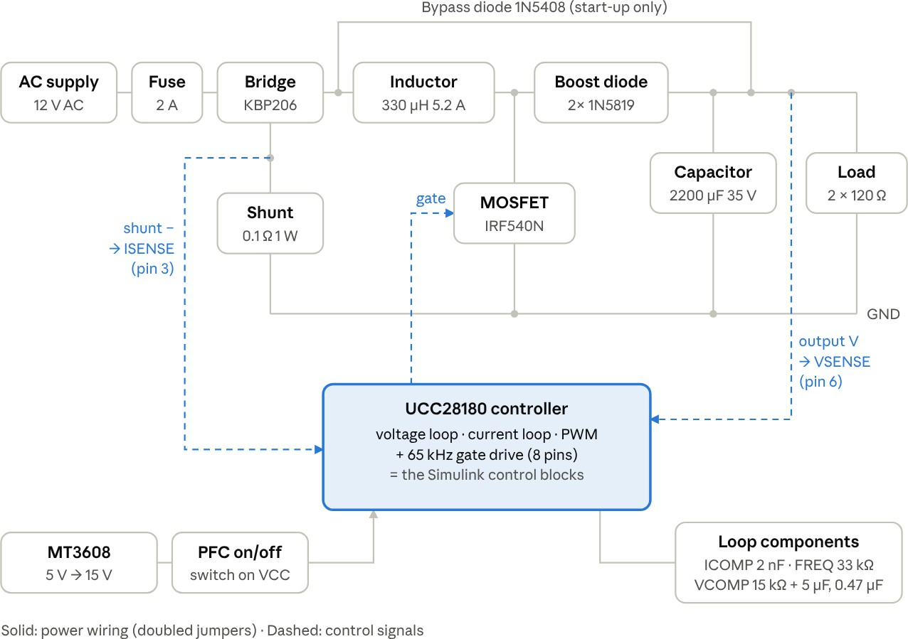
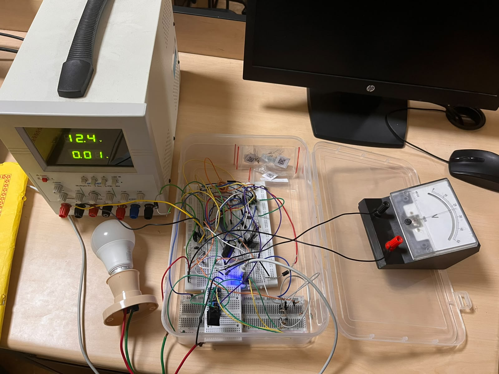

# Boost PFC Converter with ANN-Based Capacitor Health Monitoring

Single-phase **boost power factor correction (PFC)** front-end for EV on-board charger applications, designed and simulated in **MATLAB/Simulink**, combined with an **artificial neural network (ANN)** method for DC-link capacitor health monitoring. A low-voltage **10 W breadboard prototype** based on the **Texas Instruments UCC28180** CCM PFC controller was built and tested.

Team project for **BEEE301L Power Electronics**, VIT Vellore (Fall Semester 2026-27). Public version published by Sankalp Singh Bais; teammate and faculty names withheld for privacy.

## Highlights

- **Converter design (300 W study):** single-phase boost PFC, 230 VAC input to a regulated 400 V DC link, continuous conduction mode with average-current-mode control (outer voltage loop + multiplier + inner current loop).
- **Simulation results (MATLAB/Simulink):** power factor **0.997**, current THD **4.0%**, output-voltage ripple **2%** of the DC link.
- **Hardware prototype (10 W):** same topology scaled to 12 VAC to 24 V DC at ~65 kHz using a UCC28180 controller on a breadboard; built and tested.
- **ANN capacitor health monitoring:** a feedforward neural network (8 hidden neurons) estimates DC-link capacitance from five features of the simulated output-voltage waveform (ripple, mean, standard deviation, maximum, minimum). The dataset spans 41 simulation cases with capacitance varied from 120 uF down to 60 uF; degradation is flagged when the estimated capacitance falls below 80% of nominal (96 uF).

> Performance figures above are simulation results from the course report's MATLAB/Simulink studies. Hardware performance measurements are not included in this public version.

## System overview

The power stage is a conventional boost PFC: diode bridge (KBP206), boost inductor, MOSFET switch (IRF540N), boost diode, start-up bypass diode, DC-link capacitor and load, with a current-sense shunt in the return path.

Average-current-mode control uses two nested loops: a slow outer voltage loop sets the current amplitude, a multiplier shapes it with the rectified line voltage, and a fast inner current loop produces the duty cycle.

## Simulation

The converter is modelled in MATLAB/Simulink with Simscape Electrical components.

With the controller disabled, the bridge rectifier draws narrow, pulsed line current; with average-current-mode PFC enabled, the line current follows the line voltage.

| PFC disabled | PFC enabled |
|---|---|
|  |  |

## Hardware prototype

The 10 W prototype keeps the same topology and control at 12 VAC to 24 V DC, switching at ~65 kHz. Key parts: KBP206 bridge, 330 uH toroidal inductor, IRF540N MOSFET, 2x 1N5819 boost diodes, 1N5408 bypass diode, 2200 uF output capacitor, 0.1 ohm current shunt, 2x 120 ohm load resistors, and a UCC28180 controller (on an SOIC-to-DIP adapter) powered at 15 V from an MT3608 boost module.

## Repository contents

- `report/Boost-PFC-ANN-Capacitor-Monitoring-Report.pdf` - full course project report (public version): design calculations, literature survey, simulation studies, hardware implementation, BOM and results.
- `images/` - figures used in this README.

## Tech stack

MATLAB/Simulink (Simscape Electrical) - Neural Network Toolbox - TI UCC28180 CCM PFC controller - analog power stage on breadboard.

## Notes

- This is a team course project; the public version omits register numbers and team/faculty names.
- The report references a fixed-step Python switching model (Appendix A); its code was not part of the shared document and is therefore not included here.
